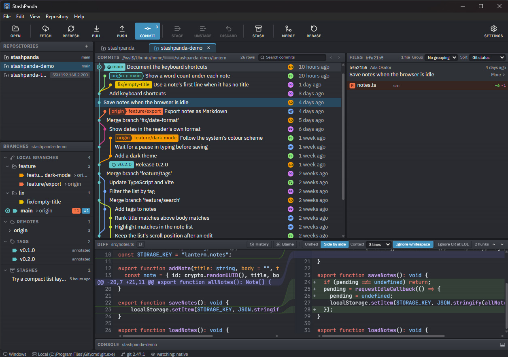
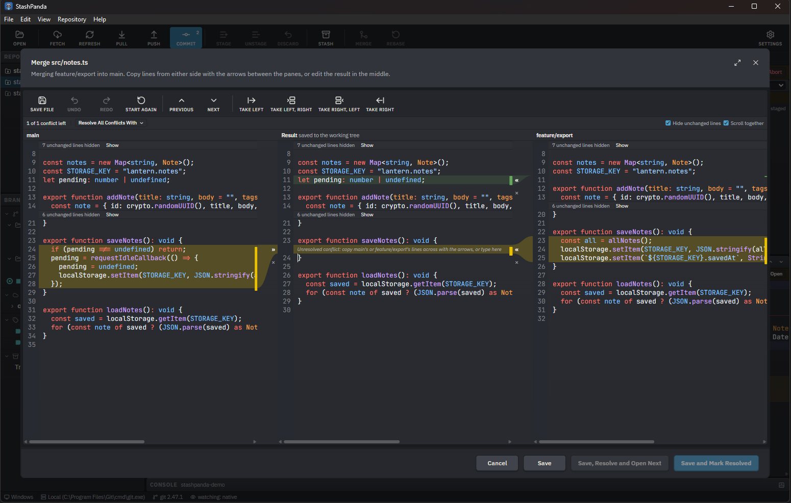
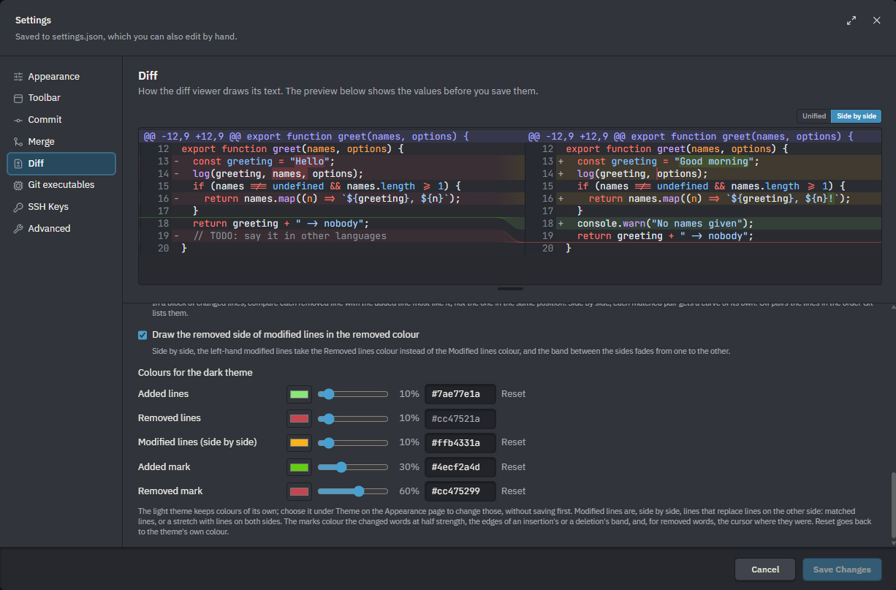
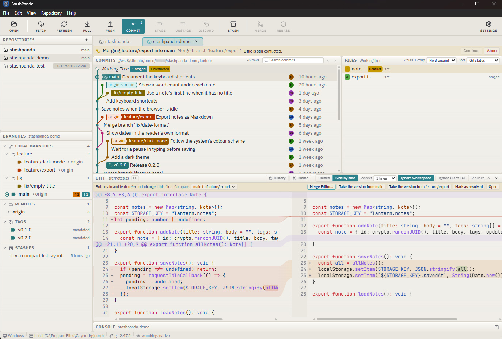

# StashPanda

A lightweight but fully featured standalone desktop Git GUI. It does not bundle a Git install, it works with your existing installed Git and its configuration.

> [!IMPORTANT]
> StashPanda is still in early development. While it has been thoroughly tested on Windows and WSL, please take care when using it on your repositories.


## Features



- **Visual commit graph**: with customisable branch colours.
- **First class support for repositories over SSH and inside WSL**: every Git command for that
  repository runs locally on the machine or distro that holds that repo.
- **Lightning fast**: All low level git commands are handled by Rust and repo changes and commit graphs are cached for quick open times.
- **Clone into folders that already have files**: StashPanda will add only the repository files that are missing and never overwrites anything, so your own files show up as changes against the repository.
- **Built-in SSH key manager**: it reads OpenSSH, PEM, PKCS#8 and PuTTY `.ppk` keys, encrypted or
  not, and converts between them.
- **Tabbed repository interface**: Have many repos open at once, switch between them instantly.
- **The usual Git commands**: Stage, unstage and discard whole files or single lines. Fetch, pull, push and sync, with automatic fetch in the background.
- **Branches, tags and stashes support**: create, rename, delete, check out, fast-forward and set upstreams.
- **Merges and conflict handling:** Merge, rebase, cherry-pick, revert and reset, with a three-pane editor for resolving conflicts. 
- **Side-by-side and unified diffs** with syntax highlighting, and an extremely customisable diff viewer.
- **Not opinionated**: every design choice has been made to be customisable, so you can configure almost everything: light and dark themes, commit graph style, diff fonts and syntax highlighting, and a zoom setting for high DPI displays.  
- **Transparent git log**: every Git command and output is shown in the Console.
- **File history and blame**.
- **Commit search.**

Built with [Tauri 2](https://tauri.app), [Vue 3](https://vuejs.org) and
[Tailwind CSS 4](https://tailwindcss.com).

How the app works, and the decisions behind it, are in
[docs/architecture.md](docs/architecture.md). What is still to build is in
[docs/next-steps.md](docs/next-steps.md).

## Layout

- `src/` – the Vue frontend, built by Vite.
  - `src/lib/bindings.ts` – **generated** TypeScript bindings for every Rust command and event.
    Regenerate with `cd src-tauri && cargo test export_bindings`; never edit by hand.
  - `src/stores/` – Pinia stores: settings, UI state, repository library, open sessions.
  - `src/components/shell/` – toolbar, repository and branch panels, tab strip, console, dialogs.
  - `src/components/graph/`, `files/`, `diff/` – the commit graph, file lists and diff viewer.
  - `src/components/ui/` – the shared UI components: buttons, dialogs, menus, tooltips and the like.
- `src-tauri/src/` – the Rust side. `transport/` reaches Git locally, through `wsl.exe` or over
  SSH; `git/` runs and parses Git commands; `graph/` orders and lays out the commit graph;
  `storage/` is the SQLite cache; `watch/` detects changes; `keys/` is the SSH key manager;
  `ipc/` holds the Tauri commands.
- `docs/architecture.md` – how the app works, and the pitfalls found while building it.
- `docs/next-steps.md` – the work that is still open.

## Commands

```bash
npm install            # install frontend dependencies
npm run dev            # frontend only, in the browser at http://localhost:1420
npm run build          # type-check with vue-tsc, then build the frontend into dist/
npm run tauri dev      # run the desktop app with hot reload
npm run tauri build    # build the release binary and installers
cd src-tauri && cargo test   # Rust unit and end-to-end tests, also regenerates bindings.ts
npm test               # frontend unit tests (Vitest)
```

## Running on Linux and WSL

The Linux build runs inside WSL and appears on the Windows desktop through WSLg:

```bash
npm run tauri dev
```

Settings live in `~/.config/com.mikepote.stashpanda/settings.json`. The commit cache and the
remembered UI state (panel sizes, column widths, open tabs, the Console, Files panel and diff header
choices, and each repository's hidden branches) live in
`~/.local/share/com.mikepote.stashpanda/stashpanda.sqlite`.

## Building for Windows

The Windows binary is built natively on Windows; cross-compiling from WSL is not set up.

1. Install [rustup](https://rustup.rs) (MSVC toolchain) and the Visual Studio Build Tools with the
   "Desktop development with C++" workload. WebView2 is already present on Windows 11.
2. Install Node.js 20 or newer.
3. Check the repository out on the Windows filesystem (for example `C:\src\stashpanda`), not
   through `\\wsl.localhost`, which is very slow for Cargo.
4. In PowerShell: `npm install`, then `npm run tauri dev` or `npm run tauri build`.

The `russh` SSH client is built with the `ring` backend, so no CMake or NASM is required.

## Prerequisites

- Node.js 20 or newer.
- The Rust toolchain, installed with [rustup](https://rustup.rs).
- The Tauri system libraries for your platform: https://tauri.app/start/prerequisites/
- Git 2.36 or newer on whichever machine or WSL distro holds the repositories.

## Working on the Windows version from WSL

The source is designed to live on a WSL filesystem (or another Linux filesystem), but `node_modules/` and `src-tauri/target/` hold
platform-specific binaries, so Windows cannot build from the same folder. `scripts/windows.sh`
mirrors the source (without those folders) to a Windows folder with `rsync`, then runs the
Windows toolchain there through WSL interop. Copy `.env.example` to `.env` and set
`STASHPANDA_WIN_DIR` to that folder, for example `C:\src\stashpanda`. Then run these from a WSL
shell:

```bash
npm run win:ux       # UX work: Vite runs in WSL, the Windows app loads from it, edits hot reload
npm run win:dev      # mirror, then run the desktop app entirely on Windows (Vite included)
npm run win:build    # mirror, build the Windows release binary and installers, copy them to bundle/ in both folders
npm run win:sync     # mirror the source and run npm install on Windows, nothing else
```

### How `win:ux` works

1. The source is mirrored to the `STASHPANDA_WIN_DIR` folder and `npm install` runs there.
2. Vite starts in WSL on port 1420. WSL2 forwards Windows `localhost:1420` to it.
3. The Windows `tauri dev` starts with `src-tauri/tauri.wsl-dev.conf.json` merged in, which empties
   `beforeDevCommand` so Windows does not start its own Vite. The app's WebView loads
   `http://localhost:1420`, which is the WSL Vite server.
4. Edits to Vue, TypeScript and CSS files in WSL hot reload in the running Windows app. Rust changes
   need Ctrl-C and a re-run, because the Rust code is compiled from the mirror.
5. Ctrl-C stops Vite and kills the whole Windows process tree (npm, the Tauri CLI, Cargo and the
   app). The Windows side's output is written to `tauri-dev.log` and `tauri-dev.err.log` in the
   mirror folder and streamed into the WSL terminal.

The mirror is one-way. Edit the code in WSL and re-run the script; edits made in the mirror are
overwritten on the next sync.

### Windows prerequisites

- rustup with the `stable-x86_64-pc-windows-msvc`
toolchain 
- Node.js 
- Visual Studio with the "Desktop development with C++" workload **and** the
Windows 10/11 SDK component
- the WebView2 runtime

Without the SDK component, Rust cannot find
the MSVC linker and falls back to Git's `link.exe`, which fails with `link: extra operand`.

## AI Disclosure

See [AI_DISCLOSURE.md](/AI_DISCLOSURE.md)

## Licence

StashPanda is released under the [MIT License](LICENSE). Copyright (c) 2026 Michael Pote.
